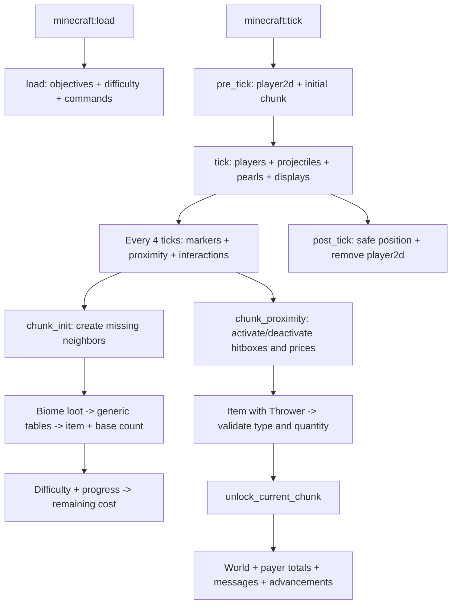

# Chunklock Java behavior reference

Use this guide to understand connected behavior before implementing Bedrock features.
It documents a local snapshot of 275 Java data files: 76 functions, 151 loot tables, 22 predicates, 24 advancements and two function tags.

**Source boundary:** Java source is deliberately excluded from this repository. On the original machine it is at
`C:\_Others\Chunklock\java_mod\data`, or `../java_mod/data` relative to the repository.
Source paths in these documents are local locators, not GitHub links. The English documentation is readable without those files.

## Reading guide

| Document | Question answered |
| --- | --- |
| [Runtime flow](runtime-flow.md) | What runs from initial load through payment and unlocking, and in what order? |
| [State model](state-model.md) | Who owns data, what is temporary, and how are costs calculated? |
| [Functions](functions.md) | What does each of the 76 functions do, who calls it and what does it call? |
| [Loot tables](loot-tables.md) | What items, weights, counts and child tables occur in all 151 tables? |
| [Predicates and advancements](predicates-advancements.md) | What filtering and progression conditions does each file define? |
| [File catalog](file-catalog.md) | What is the responsibility and source location of every file? |
| [Source observations](source-observations.md) | Where do source comments/UI differ from commands, and what needs runtime verification? |
| [Bedrock mapping](bedrock-porting.md) | How do the responsibilities map to Bedrock, and what is actually implemented? |
| [Source index](source-index.json) | What normalized hashes and static resource relationships were extracted? |

## Connected system overview



This overview shows responsibilities, not a literal call from `tick` to `post_tick`.
The function tag independently schedules `pre_tick -> tick -> post_tick` in that order.

## Evidence limits

The static index resolves 626 internal resource references, including direct calls, clickable commands,
nested loot tables and advancement parents/rewards. Every extracted target exists in the local snapshot.
This does not prove that every branch executes successfully, establish Java version compatibility or constitute gameplay testing.
Bedrock currently has only a player-join readiness message.

When comments or UI disagree with executable commands, document both. Describe the commands as reference behavior
and identify any deliberate changes made for Bedrock. The local Java snapshot credits AvidMc and Quillbee.

## Maintaining generated documentation

With the local Java data directory available:

```powershell
python tools/reference_docs.py --check
```

The generator parses every JSON file, requires a reviewed description for every function, resolves resource targets
and compares generated output. Set `CHUNKLOCK_JAVA_REFERENCE` if the source is elsewhere.
After an authorized reference update, review `function-notes.json` and regenerate:

```powershell
python tools/reference_docs.py
```

Generated files are `file-catalog.md`, `functions.md`, `loot-tables.md`, `predicates-advancements.md` and `source-index.json`.
Runtime, state, observations and mapping documents are maintained manually and must be reviewed when reference behavior changes.

For a standalone clone without Java source, run `python tools/check_docs.py` to check English-language regressions,
local links and published reference coverage. This check does not claim to revalidate absent Java files.
