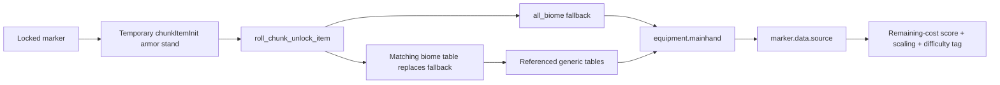

# Runtime flow and connected behavior

Function names below refer to the external Java directory `java_mod/data/chunklock/function`.
[functions.md](functions.md) lists every source locator, caller, callee and extracted source line.
Ticks in this guide are game ticks, not rendering frames.

## Bedrock implementation snapshot

The Bedrock add-on is a separate implementation, not a datapack loader. `scripts/main.ts` starts the protection hooks, then starts diagnostics, walls, requirement displays, movement collision, bounded chunk expansion/requirement initialization and projectile tracking. Wall and requirement-display reconciliation runs every ten ticks; collision and projectile movement checks use their own per-tick intervals. Chunk records, open-cell access and per-chunk requirement JSON are stored separately as world dynamic properties.

`chunks.ts` seeds the player's current open cell once per dimension, discovers only a bounded neighborhood while players are nearby, and assigns loot-derived requirements to locked records. `walls.ts` and `displays.ts` derive temporary helpers from the shared `wallEdges` geometry. Requirement displays appear only where an open cell borders a locked cell with a saved cost, and only while a player is nearby. The display shows the saved item and remaining cost. Current code has not yet connected display clicks to payment or unlocking; those remain the next milestone.

## 1. Datapack loading

`java_mod/data/minecraft/tags/function/load.json` invokes `chunklock:load`.
It creates coordinate, UUID, payment, progression, tick and trigger objectives; populates the `Integers` constants;
sets progression displays in the player list and below names; defaults difficulty to Normal (2) when unset/invalid;
and sets `respawn_radius` to zero.

The main update later invokes `init_player` for players without `playerInit`.
It copies their UUID into four scores, enables their command triggers and records initialization.

## 2. One tick's lifecycle

`java_mod/data/minecraft/tags/function/tick.json` defines this order:

1. **pre_tick:** runs `pre_tick_player` for every player. Creates a temporary `player2d` marker using the player's X/Z
   at Y=128 in Overworld or Y=64 in Nether/End. If no chunk marker is within 12 blocks and the area is loaded,
   it creates an unlocked starting chunk.
2. **tick:** initializes new players/projectiles, then updates players, pearls and item displays.
   It increments the tick counter and returns until the fourth tick. On that tick it performs
   marker propagation, proximity transitions and interaction processing, in that order.
3. **post_tick:** records a new safe position for players outside locked chunks, then removes temporary `player2d` markers.

Returning from `tick` does not remove `post_tick` from the function tag.
Movement/projectile checks run more frequently than expensive chunk helper updates.
At 20 game ticks per second, four ticks are approximately 0.2 seconds; real elapsed time can increase under lag.

## 3. Starting chunks and neighbor propagation

`pre_tick_player -> init_containing_chunk -> init_chunk_marker` creates a centered chunk marker.
The `currentPlayer` context makes this starting chunk unlocked. It does not pass through `unlock_current_chunk`
and therefore does not increment unlock credits.

Every fourth tick, propagation follows:

```text
tick_chunk_marker
  -> init_neighbors
  -> init_neighbor_north/east/south/west
  -> init_containing_chunk
  -> init_chunk_marker
```

Neighbor centers are 16 blocks apart. Creation requires loaded terrain and a nearby player; the system does not expand indefinitely without players.
Each direction has a separate initialization tag because neighboring areas may load at different times.
`initNeighborsDone` is set only after all four directions are initialized. Existing markers are reused rather than duplicated.
Chunks created through this neighbor path start locked.

`init_chunk_marker` exempts chunks in biome `the_end` whose slightly reduced chunk column contains no End Crystal.
It removes `locked` and adds `unlocked` without going through the credited-unlock path.

## 4. Assigning a locked chunk's requirement

`init_locked_chunk` creates colored border block displays and calls `init_locked_chunk_unlock_item`.
A temporary armor stand receives the random loot result:



The biome is checked at the execution position and Y, not at every height in the column.
The fallback selects stone with a base count of 1-2. A matching biome table replaces that result.
Nested tables reuse groups such as wood, ores, mob-related items and structures.
After copying the selected item into `data.source`, the armor stand is deleted.
A scoreboard stores the authoritative remaining cost, which can exceed a single item stack.
See [state-model.md](state-model.md) for the actual scaling formula.

## 5. Activating nearby presentation and interaction helpers

`tick_chunk_player_proximity_check` clears current proximity flags, uses `player2d` to locate each player's unlocked chunk,
and marks locked markers in the neighboring search bounds.
It compares `chunkHasPlayerNearby` and `chunkHasPlayerNearbyPrev`:

| Previous -> current | Function | Result |
| --- | --- | --- |
| Not nearby -> nearby | `on_chunk_become_relevant` | Creates vertically stacked interaction hitboxes |
| Nearby -> not nearby | `on_chunk_cease_relevant` | Removes item/text displays and interaction hitboxes |
| Still nearby | `tick_relevant_chunk` | Renders requirements and processes submitted items |

Border block displays were created during locked-chunk initialization; they are not recreated by each proximity update.
Interaction entities receive clicks and obstruct mining. Movement exclusion is handled separately by collision functions.

`render_chunk_items` first requires a nearby unlocked marker, then checks players on each side.
Each `check_render_chunk_item_*` depends on a side-specific execution position prepared by its caller.
It creates an item display with a text-display passenger, records side tags and prevents duplicates using a rendered tag.
`tick_chunk_item_displays` adjusts Y to the nearest player passing the height predicate.
`update_chunk_items` refreshes existing sides after a reroll or partial payment.

## 6. Paying with items

`tick_relevant_chunk -> tick_item_in_chunk -> check_submit_chunk_item` processes item entities that have not been marked `itemProcessed`.
Only items with `Thrower` are sent for payment. The target is the nearest locked marker within 15 blocks on the dimension's lookup plane.
Items without a player thrower are marked processed rather than silently counted as payment.

`check_submit_chunk_item` copies `data.source` to `data.comparison` and attempts to replace `comparison.id` with the submitted item's ID.
A successful modification (`success=1`) means the ID differed; no modification (`success=0`) means it matched.
Only the ID is compared, not the custom name, enchantments or other components.
A `minecraft:barrier` shortcut forces the type and quantity tests to pass for Creative testing.

The item's four-part Thrower UUID identifies `itemThrower`, who receives final credit and returned items.
The payment outcomes are:

| Outcome | Remaining cost | Submitted stack |
| --- | --- | --- |
| Wrong type | Unchanged | Failure sound/particles; caller returns the original stack |
| Correct but insufficient | Reduced by submitted count | Entire stack consumed; price display updated |
| Exact payment | Zero | Entire stack consumed; chunk unlocked |
| Excess payment | Nonpositive | Only the excess remains; chunk unlocked and excess returned |

If the item survives, the caller sets `PickupDelay=0`, adds `itemProcessed` and teleports it to the tagged thrower.
It then clears shared thrower/current-chunk context. Ownership and returns require multiplayer verification;
the nearest player alone is not a substitute for evidence of the thrower.

## 7. Unlock effects

`submit_chunk_item_success -> unlock_current_chunk` performs these effects in order:

1. Removes `locked` and adds `unlocked` on the marker.
2. Removes border block displays/interactions in its column and item/text displays on all four sides.
3. Increments global total and dimension-specific global progress.
4. Increments personal total and dimension-specific progress for `itemThrower`, if present.
5. Announces a payer-attributed milestone or a separate automatic-unlock message when there is no payer.
6. Grants selected item-specific advancements.

Announcement milestones use global totals: first unlock, then multiples of 8, 16, 32, 64 and 128.
Larger intervals are checked first to avoid duplicate announcements; hidden-title preferences are respected.
Personal advancement thresholds are a separate series: 16, 64, 128, 256, 512, 1024 and 2048.

## 8. Collision, dimension changes and projectiles

`tick_player -> player_chunk_collision -> find_current_chunk` detects players in locked chunks.
`exit_locked_chunk` selects their UUID-matched `prevPosMarker`, retains their viewing rotation and teleports them back.
Spectators bypass this collision check. `post_tick_player` refreshes safe positions only outside locked chunks.

The `util/change_dimension` advancement invokes `on_change_dimension`, which adds `awaitingDimensionLoad`
and revokes the advancement so it can fire again. Once the destination position is loaded,
`tick_player` invokes `on_dimension_loaded` to unlock a locked destination and clear the waiting flag.
An automatic destination unlock increments global progress through the unlock path but has no payer credit.

Other projectiles are associated with player Owner UUIDs. Entering a locked chunk stops their Motion,
sets inGround/DealtDamage and marks them collided. Ender pearls follow a separate path and are destroyed
to prevent teleporting into locked areas.

## 9. Commands and interaction utilities

`tick_player` processes `ChunkReroll`, `ChunkDifficulty`, `ChunkUninstall`, `ChunkSpreadPlayers`,
`ChunkHideUnlockTitle` and `ChunkShowUnlockTitle` trigger scores, then resets the processed scores.

- Reroll is allowed only on Easy. It chooses a locked marker near the player's forward position and calls `reset_chunk_items`.
- Difficulty can change only before global credited unlocks reach one. Changing the setting resets the datapack.
- Clicking an interaction while holding dye recolors the border, consumes one dye and grants `chunk_dye`.
- Clicking without dye uses a temporary item and a macro to obtain a translation key and report the item name and remaining cost.
- Spread players changes player positions and spawn points. Reset/uninstall affect the state described in [source-observations.md](source-observations.md).
